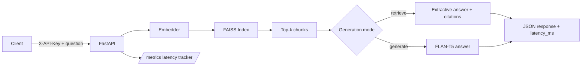

# Healthcare RAG API

Production-style RAG service for digital-health Q&A.

Built as a personal portfolio project to practice FastAPI and RAG in the healthcare domain : typed FastAPI endpoints, API-key auth, FAISS vector search, Docker packaging, GitHub Actions CI, and latency metrics.

> Demo corpus only — educational digital-health notes, not clinical advice and not real patient data.
> Created in part using Claude Code

## Architecture

```text
                 +----------------------+
   Client -----> | FastAPI (auth+API)   |
                 +----------+-----------+
                            |
                            v
                 +----------------------+
                 | RAG Pipeline         |
                 | 1) Embed question    |
                 | 2) FAISS top-k       |
                 | 3) Build answer      |
                 +-----+----------+-----+
                       |          |
                       v          v
              sentence-transformers / extractive or FLAN-T5
                       |
                       v
              markdown knowledge base (data/knowledge)
```



## Features

- `POST /v1/query` — retrieve grounded answers with source chunks
- `GET /health` — liveness + index size
- `GET /metrics` — request count, avg / p95 latency (API key required)
- API key auth via `X-API-Key`
- FAISS index persisted under `data/index`
- Docker + Compose
- CI: Ruff + Pytest (offline embeddings, no model download)

## Quick start (local)

Python **3.11+** recommended (3.11 is used in Docker/CI).

```bash
python -m venv .venv

# Windows PowerShell
.\.venv\Scripts\Activate.ps1

pip install -r requirements.txt
copy .env.example .env

# First run downloads the MiniLM embedding model
uvicorn app.main:app --reload --port 8000
```

Open docs: [http://127.0.0.1:8000/docs](http://127.0.0.1:8000/docs)

### Example request

```bash
curl -X POST http://127.0.0.1:8000/v1/query ^
  -H "Content-Type: application/json" ^
  -H "X-API-Key: dev-secret-change-me" ^
  -d "{\"question\": \"What is multimodal fusion in medical imaging?\"}"
```

### Faster local mode (no Hugging Face download)

In `.env`:

```env
OFFLINE_EMBEDDINGS=true
GENERATION_MODE=retrieve
```

Or install CI deps only:

```bash
pip install -r requirements-ci.txt
```

## Generation modes

| Mode | Behavior | When to use |
|------|----------|-------------|
| `retrieve` (default) | Top-k chunks composed into a cited answer | Demo, CI, CPU-only |
| `generate` | Same retrieval + `google/flan-t5-small` | Stronger LLM demo (slower first start) |

## Docker

```bash
docker compose up --build
```

First container start may download the embedding model.

## Tests

```bash
pip install -r requirements-ci.txt
pytest -q
```

## Project layout

```text
app/
  main.py              # FastAPI app
  auth.py              # API key dependency
  metrics.py           # latency tracker
  rag/                 # embeddings, FAISS store, generators, pipeline
data/knowledge/        # markdown corpus
scripts/build_index.py # rebuild FAISS index
tests/                 # API + pipeline tests
Dockerfile
docker-compose.yml
.github/workflows/ci.yml
```

## blurb

> Built a production-style Healthcare RAG API with FastAPI, FAISS, Sentence Transformers, Docker, and GitHub Actions — including API-key auth, source citations, and latency metrics.

## License

MIT
