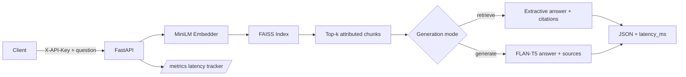

# Healthcare RAG API

Production-style Retrieval-Augmented Generation (RAG) service for digital-health Q&A.

Built as a personal portfolio project for **AI Engineer / Software Engineer** roles: typed FastAPI endpoints, API-key auth, Sentence Transformers embeddings, FLAN-T5 generation, FAISS vector search, Docker packaging, GitHub Actions CI, and latency metrics.

> Demo corpus only — openly attributed public sources. **Not medical advice.** Not affiliated with WHO, FDA, NCI, or NLM.  
> Created in part using Claude Code / Cursor.

## Knowledge sources

Indexed documents are listed with licence notes in [`data/SOURCES.md`](data/SOURCES.md).

| Source | What we use | Licence |
|--------|-------------|---------|
| [MedlinePlus / NLM](https://medlineplus.gov/mammography.html) | Mammography + breast cancer health-topic summaries | Public domain (U.S. government) |
| [CDC Breast Cancer](https://www.cdc.gov/breast-cancer/about/index.html) | Breast cancer basics + screening recommendations | Public domain (U.S. government) |
| [National Cancer Institute](https://www.cancer.gov/types/breast/mammograms-fact-sheet) | Mammograms + breast cancer screening PDQ | Public domain (U.S. government) |
| [WHO ionizing radiation Q&A](https://www.who.int/news-room/questions-and-answers/item/radiation-ionizing-radiation) | Medical imaging radiation justification/optimization | WHO / CC BY-NC-SA with attribution |
| [FDA / Health Canada / MHRA GMLP](https://www.canada.ca/en/health-canada/services/drugs-health-products/medical-devices/good-machine-learning-practice-medical-device-development.html) | 10 Good Machine Learning Practice principles | U.S. gov work / attributed Crown materials |
| [FDA MLMD transparency principles](https://www.fda.gov/medical-devices/artificial-intelligence-enabled-medical-devices/transparency-machine-learning-enabled-medical-devices-guiding-principles) | Transparency / explainability for ML medical devices | U.S. gov / joint principles with attribution |
| [WHO AI ethics guidance (2021)](https://www.who.int/publications/i/item/9789240029200) | Six consensus ethical principles for AI for health | **CC BY-NC-SA 3.0 IGO** |
| [WHO LMM guidance (2024)](https://www.who.int/publications/i/item/9789240084759) | Large multi-modal models: benefits & risks | **CC BY-NC-SA 3.0 IGO** |
| [WHO regulatory considerations (2023)](https://www.who.int/publications/i/item/9789240078871) | Documentation, validation, data quality, privacy | **CC BY-NC-SA 3.0 IGO** |
| [FDA AI-enabled medical devices](https://www.fda.gov/medical-devices/artificial-intelligence-enabled-medical-devices/transparency-machine-learning-enabled-medical-devices-guiding-principles) | U.S. device-centered AI pathway | Public domain (U.S. government) |
| [EU AI Act FAQ](https://digital-strategy.ec.europa.eu/en/faqs/navigating-ai-act) + MDCG MDR/AI Act interplay | EU horizontal AI Act + medical devices | EU public info with attribution |
| US vs EU comparison note | Side-by-side differences for healthcare AI | Educational synthesis with attribution |

Code is MIT. WHO excerpts remain CC BY-NC-SA 3.0 IGO (non-commercial, attribution, share-alike). No WHO/FDA/EU endorsement is implied.

## Architecture

```text
                 +----------------------+
   Client -----> | FastAPI (auth+API)   |
                 +----------+-----------+
                            |
                            v
                 +----------------------+
                 | RAG Pipeline         |
                 | 1) MiniLM embed      |
                 | 2) FAISS top-k       |
                 | 3) FLAN-T5 answer    |
                 +-----+----------+-----+
                       |          |
                       v          v
              Hugging Face models + cited open sources
                       |
                       v
              data/knowledge/*.md (WHO, FDA, NCI, MedlinePlus)
```



## Chat UI

Open [http://127.0.0.1:8000/](http://127.0.0.1:8000/) for a corpus-grounded chat interface.

- Uses `POST /v1/chat` with message history
- Shows source excerpts, licences, and links under each answer
- Default local API key: `dev-secret-change-me`

## Features

- `POST /v1/query` — grounded answers with source title, organisation, licence, and URL
- `POST /v1/chat` — chat-style RAG with light history-aware retrieval
- Query normalisation: corpus-aware spell correction + synonym expansion before retrieval (returns `normalized_question` / `corrections` when applied)
- Grounded LLM layer: FLAN-T5 rewrites retrieved evidence into natural prose; narrative fallback uses full sentences (no ellipsis clipping)
- `GET /health` — liveness + index size + active models
- `GET /metrics` — request count, avg / p95 latency (API key required)
- API key auth via `X-API-Key`
- Default stack: **all-MiniLM-L6-v2** + **google/flan-t5-base** (set `GENERATOR_MODEL=google/flan-t5-large` for higher quality / slower CPU)
- Docker + Compose
- CI: Ruff + Pytest (offline hash embeddings, no model download)

## Quick start (local)

Python **3.11+** recommended (3.11 is used in Docker/CI).

```bash
python -m venv .venv

# Windows PowerShell
.\.venv\Scripts\Activate.ps1

pip install -r requirements.txt
copy .env.example .env

# First start downloads MiniLM + FLAN-T5 (can take several minutes)
uvicorn app.main:app --reload --port 8000
```

Open docs: [http://127.0.0.1:8000/docs](http://127.0.0.1:8000/docs)

### Example request

```powershell
Invoke-RestMethod -Method Post -Uri http://127.0.0.1:8000/v1/query `
  -Headers @{"X-API-Key"="dev-secret-change-me"} `
  -ContentType "application/json" `
  -Body '{"question":"What are the WHO ethical principles for AI in health?"}'
```

### Faster mode (no model download)

In `.env`:

```env
OFFLINE_EMBEDDINGS=true
GENERATION_MODE=retrieve
```

## Generation modes

| Mode | Behavior | When to use |
|------|----------|-------------|
| `retrieve` | Top-k chunks composed into a cited answer | CI / quick CPU demos |
| `generate` (default) | Same retrieval + `google/flan-t5-base` | Full portfolio demo |

## Docker

```bash
docker compose up --build
```

First container start downloads embedding + generator models.

## Tests

```bash
pip install -r requirements-ci.txt
pytest -q
```

## Project layout

```text
app/                   FastAPI + RAG pipeline
data/knowledge/        Attributed open-source markdown corpus
data/SOURCES.md        Full source + licence table
scripts/build_index.py Rebuild FAISS index
tests/                 API + pipeline tests
Dockerfile
docker-compose.yml
.github/workflows/ci.yml
```

## CV / LinkedIn blurb

> Built a production-style Healthcare RAG API with FastAPI, Sentence Transformers, FLAN-T5, FAISS, Docker, and GitHub Actions — indexing attributed open sources from WHO, FDA/Health Canada/MHRA, NCI, and MedlinePlus, with API-key auth, citations, and latency metrics.

## License

- Application code: MIT
- Knowledge excerpts: see [`data/SOURCES.md`](data/SOURCES.md)
